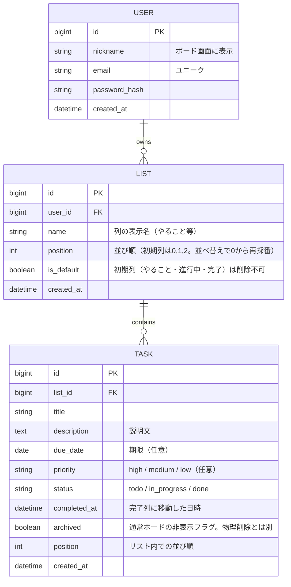

# データモデル：データ項目（TASK以外）とER図（詳細）

[← 要件定義書に戻る](../requirements.md)

タスクカード（TASK）の項目は [要件定義書9.1](../requirements.md#9-データ仕様) に記載。本ファイルは他エンティティとER図をまとめる。2026-11-15にEntityとFlywayを照合。詳細な操作上の制約は [対応表](../implementation-status.md) を参照。

## データ項目（TASK以外）

### リスト（LIST）

カンバンの列を表すエンティティ。フェーズ1〜4ではユーザーに紐付く。

| 項目 | 型 | 必須 | 備考 |
|------|----|----|------|
| ID | 数値 | ○ | 一意の識別子 |
| ユーザーID | 数値 | ○ | フェーズ3以降で必須（フェーズ1〜2は認証なし） |
| 列名 | 文字列 | ○ | 列の表示名（やること／進行中／完了／ユーザー追加列） |
| 並び順 | 数値 | ○ | 初期列は0,1,2。並べ替えで0から再採番 |
| デフォルトフラグ | 真偽値 | ○ | true の場合は初期列（やること・進行中・完了）であり削除不可 |
| 作成日時 | 日時 | ○ | 列を作成した日時 |

※ フェーズ5ではグループ所有 LIST を扱うため `グループID` カラムが追加される（詳細は [`../requirements_phase5.md`](../requirements_phase5.md) 参照）。

### ユーザー（USER）

フェーズ3で導入。

| 項目 | 型 | 必須 | 備考 |
|------|----|----|------|
| ID | 数値 | ○ | 一意の識別子 |
| ニックネーム | 文字列 | ○ | 新規登録APIは1〜50文字。DBはVARCHAR(50) NOT NULL DEFAULT空文字で、既存の試験ユーザーに空文字が残る場合がある |
| メールアドレス | 文字列 | ○ | ユニーク。ログインIDとして使用 |
| パスワード（ハッシュ） | 文字列 | ○ | 平文保存しない（ハッシュ化して保存） |
| 作成日時 | 日時 | ○ | アカウント登録日時 |

---

## ER図

### フェーズ1〜4（個人利用）

個人利用が前提のため、ユーザーは自分専用のリスト（列）とカードを保有する。

**補足：**
- 現行はusers・task_list・taskの3テーブル。ER図のUSER/LIST/TASKは論理名で、物理名はそれぞれ異なる。ID/FKはBIGINT
- TASK.completed_atはdoneへの状態更新ごとに設定され、done以外へ戻すとnull。完了一覧/検索は実装済み
- 通常一覧はarchived=falseだけを取得。完了一覧はstatus=doneが条件でarchivedも含む。ボード検索APIはarchived除外条件なし
- ボードでdoneを削除するとarchive、未完了は物理削除。完了一覧からの削除と、カスタム列削除に伴うアーカイブ済みタスクの削除は物理削除
- 認証なし/localStorage構成は初期計画。現行frontendは常に認証付きAPI/DB構成
- 物理スキーマはFlyway V1〜V12が基準。V2のcardはV4でtaskに改名され、sample_itemはV9で削除。試験データ投入もある
- LIST.is_default = true の列（やること・進行中・完了）はシステムで保護されており、削除操作を受け付けない

### フェーズ5（将来：グループ機能）

フェーズ5の ER 図と GROUP / GROUP_MEMBER などのデータ項目は別ファイル [`../requirements_phase5.md`](../requirements_phase5.md) を参照。
