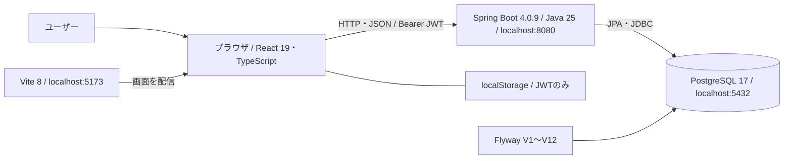

# システム構成（現行実装）

[← 要件定義書](../requirements.md) / [実装との対応表](../implementation-status.md)

## ローカルの3層構成

- タスク/カラムはDB保存。frontendにはlocalStorageへのタスク保存モードはない。
- 認証はSpring SecurityのSTATELESS + JWT、パスワードはBCrypt。JWTの既定有効期間は24時間で、Cookieは使わない。
- フロントのAPI URLはlocalhost:8080固定。バックエンドのCORS許可元はhttp://localhost:5173。Viteのポートが自動変更された場合やpreviewの別ポートでは、そのままAPIを利用できない。
- DBはDocker Composeの名前付きボリュームに永続化。SpringとComposeはbackend/.envの値を参照する。Flywayが未適用分を順に適用し、Hibernateはvalidateする。
- buildで生成したfrontend/distは静的ファイルだが、現在のSpring Bootプロジェクトが自動配信する設定・配置はない。

## 当初計画・プロトタイプ

フェーズ1〜2のブラウザ単独/localStorage構成は当初計画。prototype/は別の試作用HTML/CSS/JavaScriptとして残っている。現行Reactアプリの起動・機能説明と混同しない。

## 将来の配備・グループ機能

本番ホスティング、TLS終端、静的ファイルの本番配信、バックアップ、監視、CI/CDは現行設定にない。要件定義の稼働率・復旧時間・性能数値も測定済みの保証ではない。

フェーズ5のグループ機能は [将来設計](../requirements_phase5.md)。LISTにgroup_idを追加する案で、現行の3層構成にグループ用のAPI・Service・認可・テーブル変更を追加する必要がある。「DBテーブルだけの変更」で実現済みとはしない。
